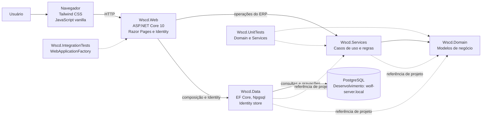
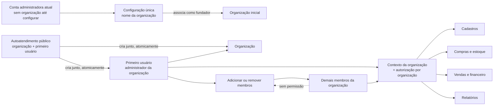
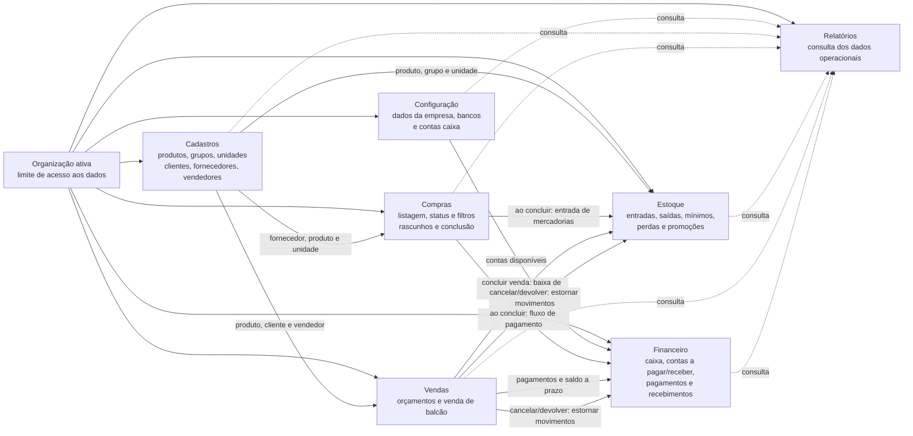

# Arquitetura do WSCD Web

Este diagrama segue o [plano de migração](../MIGRATION_PLAN.md). Autenticação, organizações e isolamento da gestão de membros estão implementados; os módulos de negócio ainda serão migrados. Linhas contínuas mostram o fluxo em execução; pontilhadas mostram referências entre projetos. Toda regra de negócio, inclusive a hoje existente em stored procedures ou triggers Firebird, será implementada em `Wscd.Services`, não no PostgreSQL.

## Aplicação e projetos

O Dev Container fornece .NET e Node no desenvolvimento; o PostgreSQL fica fora do container. A aplicação deverá ser publicada como container Docker em uma VPS gerenciada. Credenciais são locais e não fazem parte deste documento. Os testes de integração não dependem do banco de desenvolvimento.

## Organizações e módulos

O autoatendimento cria a organização junto com seu primeiro administrador em uma transação. A conta administrativa inicial já concluiu a configuração da organização. Somente o fundador pode adicionar membros ou remover seu acesso; remoção desativa a conta para manter referências históricas. A gestão de usuários filtra pelo vínculo da organização. Toda entidade de negócio deve implementar `IOrganizationScoped`, que recebe filtro global pelo contexto da organização autenticada. O banco contém as migrations `AddOrganizations` e `AddCatalogs`.

## Módulos e relações de negócio planejadas

As setas representam o fluxo alvo. Orçamentos e rascunhos de compra não movimentam estoque nem financeiro; a compra movimenta os dois ao ser concluída. Concluir uma venda de balcão baixa o estoque e lança pagamentos e eventual saldo a prazo de forma atômica. Cancelar ou devolver estorna os movimentos correspondentes, repõe apenas mercadorias efetivamente devolvidas e preserva o histórico. A branch `delphi` contém as telas e procedures antigas; elas servem para inventário, não para copiar regras de negócio ao banco novo. O relatório de comissão por vendedor permanece no escopo. Relatórios consultam os módulos e não são fonte de alteração operacional.

Os oito cadastros da Fase 5 já têm modelos, serviços, persistência e páginas Razor. O produto tem FKs compostas com `IDOrganization`, `IDSupplier`, `IDProductGroup` e `IDUnit`, impedindo referências cruzadas entre organizações. A tela de cliente e fornecedor ainda usa cidade como texto; a referência fixa de cidades e a regra de idade mínima dependente da configuração global permanecem pendentes nesta fase.
